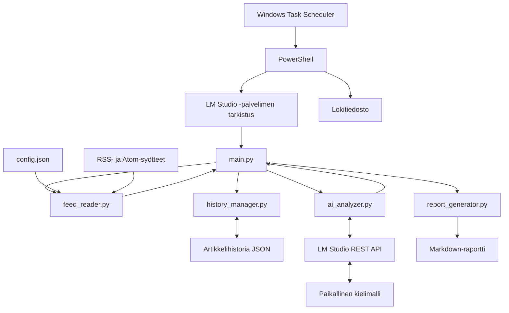

# Technology & Learning Watch

**Versio 0.1**

Technology & Learning Watch on Pythonilla toteutettu automatisoitu
teknologia- ja oppimisseurantasovellus, joka kerää ajankohtaisia
artikkeleita RSS- ja Atom-syötteistä ja analysoi niiden sisältöä
paikallisen kielimallin avulla.

Sovellus muodostaa suomenkielisen Markdown-raportin, joka auttaa
ohjelmistokehittäjää seuraamaan teknologian kehitystä, tunnistamaan
kiinnostavia aiheita ja löytämään uusia oppimismahdollisuuksia.

Projekti on toteutettu oppimis- ja portfolioharjoituksena yhteistyössä
tekoälyn kanssa. Kaikki käytetyt työkalut, kirjastot ja palvelut ovat
maksuttomia tässä käyttötarkoituksessa.

## Ominaisuudet

- Artikkelien automaattinen hakeminen RSS- ja Atom-syötteistä.
- Muokattavat tietolähteet ja aihealueet.
- Artikkelien suodattaminen julkaisupäivän perusteella.
- Lähdekohtainen artikkelien määrärajoitus.
- Artikkelien analysointi paikallisella kielimallilla.
- Suomenkieliset Markdown-raportit.
- Konkreettiset oppimisehdotukset.
- Artikkelien hyödyllisyyden arviointi.
- Aiemmin analysoitujen artikkelien tunnistaminen.
- Automaattinen viikoittainen suoritus Windowsissa.
- LM Studion API-palvelimen automaattinen käynnistäminen.
- Virheenkäsittely ja suoritusten lokitus.

## Käytetyt teknologiat

| Teknologia | Käyttötarkoitus |
|---|---|
| Python | Sovelluslogiikka |
| Requests | HTTP-pyynnöt |
| Feedparser | RSS- ja Atom-syötteiden käsittely |
| LM Studio | Paikallinen tekoälypalvelin |
| Gemma 3 4B IT | Artikkelien analysointi |
| REST API | Kommunikointi kielimallin kanssa |
| JSON | Asetukset ja artikkelihistoria |
| Markdown | Raporttien muodostaminen |
| PowerShell | Suorituksen automatisointi |
| Windows Task Scheduler | Ajastettu suoritus |
| Unittest | Automaattinen testaus |
| Git | Versionhallinta |

## Arkkitehtuuri

Sovellus on jaettu moduuleihin, joilla on omat vastuualueensa.



## Projektin rakenne

```text
technology-learning-watch/
├── ai_analyzer.py
├── config.json
├── feed_reader.py
├── history_manager.py
├── main.py
├── report_generator.py
├── run_watch.ps1
├── test_connection.py
├── test_main_error.py
├── requirements.txt
├── README.md
├── .gitignore
│
├── data/
│   └── processed_articles.json
├── logs/
└── reports/
```

Hakemistot `data`, `logs` ja `reports` muodostuvat tarvittaessa
sovelluksen suorituksen yhteydessä.

### Moduulien vastuut

| Tiedosto | Vastuualue |
|---|---|
| `main.py` | Sovelluksen suorituksen koordinointi |
| `feed_reader.py` | Artikkelien hakeminen, validointi ja suodattaminen |
| `ai_analyzer.py` | Kielimallin API-pyynnöt ja vastausten käsittely |
| `history_manager.py` | Artikkelihistorian lukeminen ja tallentaminen |
| `report_generator.py` | Markdown-raporttien muodostaminen |
| `config.json` | Sovelluksen asetukset ja tietolähteet |
| `run_watch.ps1` | Suorituksen automatisointi ja lokitus |
| `test_connection.py` | LM Studion API-yhteyden tarkistaminen |
| `test_main_error.py` | Sovelluksen virheenkäsittelyn testaus |

## Tietolähteet

Sovelluksen oletusasetuksissa käytetään seuraavia tietolähteitä:

| Lähde | Aihealue |
|---|---|
| [Python Insider](https://blog.python.org/) | Python |
| [React Blog](https://react.dev/blog) | Frontend |
| [Simon Willison](https://simonwillison.net/) | Tekoäly |
| [GitHub Blog](https://github.blog/) | Ohjelmistokehitys |
| [Mozilla Hacks](https://hacks.mozilla.org/) | Web-kehitys |

Tietolähteitä voidaan lisätä, poistaa ja muokata
`config.json`-tiedostossa ilman muutoksia Python-koodiin.

Oletusasetuksilla sovellus hakee enintään kolme artikkelia
kustakin lähteestä. Artikkelit saavat olla enintään 14 päivää vanhoja.

## Asennus Windowsissa

### Vaatimukset

- Python 3
- PowerShell
- LM Studio
- LM Studion komentorivityökalu (`lms`)
- Internet-yhteys RSS-syötteiden hakemiseen
- Riittävästi keskusmuistia paikallisen kielimallin käyttämiseen

### 1. Lataa projekti

Kloonaa GitHub-repositorio tai lataa projektin ZIP-tiedosto
ja pura se haluamaasi hakemistoon.

Avaa PowerShell projektin juurihakemistossa.

### 2. Luo Python-virtuaaliympäristö

```powershell
py -m venv .venv
```

### 3. Asenna riippuvuudet

```powershell
.\.venv\Scripts\python.exe -m pip install -r requirements.txt
```

Tarkista riippuvuuksien yhteensopivuus:

```powershell
.\.venv\Scripts\python.exe -m pip check
```

### 4. Asenna ja määritä LM Studio

Lataa ja asenna [LM Studio](https://lmstudio.ai/).

Lataa LM Studiossa sovelluksen käyttämä kielimalli:

```text
gemma-3-4b-it
```

Varmista, että LM Studion komentorivityökalu on käytettävissä:

```powershell
lms --help
```

Käynnistä paikallinen API-palvelin:

```powershell
lms server start --port 1234 --bind 127.0.0.1
```

Tarvittaessa lataa kielimalli:

```powershell
lms load gemma-3-4b-it
```

Sovellus käyttää seuraavaa paikallista API-osoitetta:

```text
http://127.0.0.1:1234/v1/chat/completions
```

API-palvelinta ei tarvitse avata lähiverkkoon.

Pidä LM Studion `Serve on Local Network` -asetus pois käytöstä.

### 5. Testaa yhteys LM Studioon

```powershell
.\.venv\Scripts\python.exe test_connection.py
```

Onnistunut yhteystesti tulostaa saatavilla olevien kielimallien
tunnisteet.

## Sovelluksen käyttäminen

Sovellus voidaan suorittaa suoraan Pythonilla:

```powershell
.\.venv\Scripts\python.exe main.py
```

Tällöin LM Studion API-palvelimen tulee olla käynnissä.

Suositeltu tapa on käyttää PowerShell-skriptiä:

```powershell
.\run_watch.ps1
```

PowerShell-skripti:

1. Aloittaa suorituksen lokituksen.
2. Tarkistaa Python-virtuaaliympäristön.
3. Tarkistaa LM Studion API-palvelimen tilan.
4. Käynnistää palvelimen tarvittaessa.
5. Tarkistaa kielimallin saatavuuden.
6. Käynnistää Python-sovelluksen.
7. Käsittelee sovelluksen paluukoodin.
8. Tallentaa suorituksen lokitiedostoon.

## Sovelluksen toimintaperiaate

1. Luetaan asetustiedosto ja artikkelihistoria.
2. Haetaan artikkelit määritellyistä tietolähteistä.
3. Suodatetaan liian vanhat ja puutteelliset artikkelit.
4. Poistetaan artikkelien kuvauksista HTML-merkinnät.
5. Ohitetaan aiemmin analysoidut artikkelit ja saman
   suorituksen aikana havaitut URL-osoitteiden kaksoiskappaleet.
6. Lähetetään uusien artikkelien otsikot ja kuvaukset
   paikalliselle kielimallille.
7. Muodostetaan onnistuneista analyyseistä Markdown-raportti.
8. Päivitetään artikkelihistoria onnistuneen raportin
   tallentamisen jälkeen.

Jos uusia artikkeleita ei löydy, uutta raporttia ei muodosteta.

## Raportin sisältö

Jokaisesta analysoidusta artikkelista tallennetaan:

- Artikkelin otsikko
- Tietolähde
- Aihealue
- Julkaisupäivä
- Lyhyt tiivistelmä
- Hyöty ohjelmistokehittäjälle
- Konkreettinen oppimisehdotus
- Osaamisalueet
- Hyödyllisyysarvio asteikolla 1–5
- Linkki alkuperäiseen artikkeliin

Kielimallia ohjeistetaan muodostamaan enintään 100 sanan
suomenkielinen analyysi.

### Esimerkki analyysin rakenteesta

Seuraava on havainnollistava esimerkki, ei sovelluksen
todellisesta suorituksesta poimittu analyysi.

**Tiivistelmä:** Artikkeli käsittelee REST API -pyyntöjen
luotettavuuden parantamista aikakatkaisujen ja
uudelleenyritysten avulla.

**Hyöty:** Auttaa kehittämään paremmin yhteysvirheitä
sietäviä sovelluksia.

**Oppimisehdotus:** Toteuta Python-harjoitus, jossa
HTTP-pyyntöjen uudelleenyrityksissä käytetään
eksponentiaalisesti kasvavaa odotusaikaa.

**Osaamisalue:** Python, REST API, virheenkäsittely.

**Hyödyllisyys:** 5/5 – Aihetta voi hyödyntää käytännön
integraatioiden kehittämisessä.

### Raporttien tallennus

Raportit tallennetaan `reports/`-hakemistoon.

Tiedostonimi sisältää raportin muodostamisajankohdan,
jotta eri suoritusten raportit voidaan säilyttää erillisinä.

## Automaattinen suoritus

Sovellus voidaan ajastaa Windowsin Tehtävien ajoituksen
(Task Scheduler) avulla.

Projektissa käytetty ajastus on kerran viikossa,
lauantaisin kello 09.00.

### Tehtävän määrittäminen

Luo uusi tehtävä seuraavilla asetuksilla:

| Asetus | Arvo |
|---|---|
| Nimi | Technology & Learning Watch |
| Käynnistin | Viikoittain, lauantai klo 09.00 |
| Ohjelma | `powershell.exe` |
| Suoritustapa | Vain käyttäjän ollessa kirjautuneena |
| Suurimmat käyttöoikeudet | Ei |
| Suorituksen enimmäiskesto | 1 tunti |
| Samanaikaiset suoritukset | Älä käynnistä uutta esiintymää |

Ohjelman argumentit:

```text
-NoProfile -NonInteractive -File "C:\polku\technology-learning-watch\run_watch.ps1"
```

Aloitushakemisto:

```text
C:\polku\technology-learning-watch
```

Korvaa esimerkkipolku projektin todellisella sijainnilla.

Tehtävä voidaan määrittää käynnistymään mahdollisimman pian,
jos ajastettu suoritus jää väliin.

Tietokoneen tulee olla käynnissä ja käyttäjän kirjautuneena,
jotta tehtävä voidaan suorittaa näillä asetuksilla.

## Artikkelihistoria

Aiemmin onnistuneesti analysoitujen artikkelien URL-osoitteet
tallennetaan tiedostoon:

```text
data/processed_articles.json
```

Artikkelihistorian avulla vältetään saman artikkelin
toistuva analysointi.

Historia tallennetaan ensin väliaikaiseen tiedostoon,
jolla korvataan varsinainen historiatiedosto.

Artikkeli merkitään käsitellyksi vasta onnistuneen
analyysin ja raportin tallentamisen jälkeen.

Jos artikkelihistoria poistetaan, aiemmin käsiteltyjä
artikkeleita voidaan analysoida uudelleen, mikäli ne
täyttävät edelleen hakuasetukset.

## Lokitus

PowerShell-skriptin suoritukset tallennetaan
`logs/`-hakemistoon.

Lokit sisältävät muun muassa:

- Suorituksen aloitus- ja päättymisajankohdan.
- LM Studion API-palvelimen tilan.
- Haettujen artikkelien määrän.
- Uusien ja ohitettujen artikkelien määrän.
- Epäonnistuneet tietolähteet.
- Analyysien suoritusajat.
- Mahdolliset virheilmoitukset.
- Muodostetun raportin sijainnin.

Lokien avulla voidaan seurata myös ajastettujen
suoritusten onnistumista.

## Virheenkäsittely

Sovelluksessa on huomioitu muun muassa seuraavat
virhetilanteet:

- Virheellinen asetustiedosto.
- HTTP- ja yhteysvirheet.
- Verkkopyyntöjen aikakatkaisut.
- Virheelliset tai liian suuret RSS-syötteet.
- Puutteelliset artikkelitiedot.
- LM Studion API-yhteyden epäonnistuminen.
- Virheellinen tai tyhjä kielimallin vastaus.
- Kesken jäänyt kielimallin vastaus.
- Raportin tallennusvirheet.
- Artikkelihistorian luku- ja tallennusvirheet.

Yksittäisen tietolähteen tai artikkelianalyysin
epäonnistuminen ei estä muiden artikkelien käsittelyä.

Onnistuneista analyyseistä muodostetaan raportti,
vaikka osa suorituksesta epäonnistuisi.

Sovelluksen paluukoodit:

| Paluukoodi | Merkitys |
|---|---|
| `0` | Onnistunut suoritus |
| `1` | Epäonnistunut tai osittain onnistunut suoritus |

Myös suoritus, jossa ei löydy uusia artikkeleita,
on onnistunut, mikäli tietolähteiden hakemisessa
ei tapahtunut virheitä.

## Tietoturva ja yksityisyys

Projektissa on pyritty huomioimaan tietoturva
ja yksityisyys osana sovelluksen suunnittelua.

### Paikallinen tekoäly

- Kielimallia suoritetaan omalla tietokoneella.
- API-palvelin käynnistetään loopback-osoitteeseen `127.0.0.1`.
- Artikkelien analysointiin ei käytetä ulkoista tekoälypalvelua.
- Sovellus ei tarvitse maksullisia API-avaimia.
- Sovellus ei anna kielimallille tiedosto- tai komentorivityökaluja.
- Raportit ja artikkelihistoria tallennetaan paikallisesti.

### Verkkopyynnöt ja aineiston käsittely

- RSS-lähteet määritellään paikallisessa asetustiedostossa.
- RSS-lähteiltä edellytetään HTTPS-osoitetta.
- Verkkopyyntöjen automaattiset uudelleenohjaukset on estetty.
- Verkkopyynnöissä käytetään aikakatkaisuja.
- Yksittäisen RSS-syötteen koko on rajattu viiteen mebitavuun.
- Artikkelien kuvauksista poistetaan HTML-merkinnät.
- Kielimallille lähetettävien otsikoiden pituus on rajattu
  500 merkkiin ja kuvausten pituus 3000 merkkiin.
- API-vastausten rakennetta validoidaan.
- Kielimallia ohjeistetaan käsittelemään artikkelien
  sisältöä epäluotettavana aineistona ja olemaan
  noudattamatta aineiston sisältämiä ohjeita.

Nämä toimenpiteet vähentävät riskejä, mutta eivät takaa
täydellistä suojaa esimerkiksi prompt injection -hyökkäyksiltä.

Asetustiedostoon tulee lisätä vain luotettuja tietolähteitä.
HTTPS-vaatimus ei yksin estä SSRF-hyökkäyksiä.

### Versionhallinta

Git-versionhallinnan ulkopuolelle rajataan:

- Python-virtuaaliympäristö.
- Pythonin välimuistitiedostot.
- Artikkelihistoria.
- Muodostetut raportit.
- Lokitiedostot.
- Ympäristömuuttujatiedostot.
- Editorikohtaiset asetukset.

## Testaus

LM Studion API-yhteys voidaan testata komennolla:

```powershell
.\.venv\Scripts\python.exe test_connection.py
```

Kielimallin analyysitoimintoa voidaan testata erikseen:

```powershell
.\.venv\Scripts\python.exe ai_analyzer.py
```

RSS-syötteiden hakemista voidaan testata komennolla:

```powershell
.\.venv\Scripts\python.exe feed_reader.py
```

Automaattinen virheenkäsittelytesti suoritetaan komennolla:

```powershell
.\.venv\Scripts\python.exe -m unittest test_main_error.py
```

Testissä simuloidaan kielimallin yhteysvirhettä ja
varmistetaan, ettei epäonnistuneesta analyysistä muodosteta
raporttia eikä artikkelihistoriaa päivitetä.

Kehityksen aikana on testattu myös:

- Artikkelien hakeminen kaikista määritellyistä lähteistä.
- Raportin muodostaminen paikallisen kielimallin avulla.
- Aiemmin käsiteltyjen artikkelien ohittaminen.
- Virheellisen RSS-osoitteen käsittely.
- LM Studion yhteysvirheen käsittely.
- PowerShell-skriptin suorittaminen palvelimen ollessa käynnissä.
- LM Studion API-palvelimen automaattinen käynnistäminen.
- Ajastetun tehtävän käynnistäminen manuaalisesti.
- Suoritusten lokitus ja paluukoodit.

## Tunnetut rajoitukset

- Analyysi perustuu RSS-syötteen otsikkoon ja kuvaukseen,
  ei välttämättä artikkelin koko sisältöön.
- Kielimallin tuottama sisältö voi sisältää asiavirheitä,
  kielellisiä virheitä tai puutteellisia oppimisehdotuksia.
- Kielimallin hyödyllisyysarvio on subjektiivinen.
- Raportin pituus perustuu kielimallille annettuun ohjeeseen,
  eikä tarkkaa sanamäärää validoida ohjelmallisesti.
- Artikkelien tunnistaminen perustuu URL-osoitteisiin.
- Lähdekohtainen määrärajoitus tehdään ennen historian
  tarkistamista, joten osa uusista artikkeleista voi jäädä
  käsittelemättä.
- Kaikki tietolähteet eivät julkaise uusia artikkeleita
  viikoittain.
- Analyysien nopeus riippuu kielimallista ja tietokoneen
  suorituskyvystä.
- Artikkelien aihekohtaista relevanssia ei suodateta
  erillisellä ohjelmallisella tarkistuksella.
- Samanaikaisia manuaalisia suorituksia ei ole estetty
  sovellustasolla.
- Raporttien Markdown-sisältöä ei kokonaisuudessaan
  sanitisoida.
- Automaattisten testien kattavuus on vielä rajallinen.
- Ajastusratkaisu on toteutettu Windowsille.

Raportteja tulee käsitellä epäluotettavana aineistona.
Tarkista tekoälyn tuottamat tiedot alkuperäisistä lähteistä
äläkä suorita raportissa mahdollisesti esiintyviä komentoja
tarkistamatta niitä ensin.

## Mahdolliset jatkokehityskohteet

- Automaattisten testien kattavuuden laajentaminen.
- Artikkelien määrärajoituksen ja historian käsittelyn
  yhteensovittaminen.
- Artikkelien relevanssin arviointi.
- Raporttien järjestäminen hyödyllisyyden perusteella.
- Viikoittaisen oppimisyhteenvedon muodostaminen.
- Kielimallin määrittäminen asetustiedostossa.
- Rakenteisten tekoälyvastausten hyödyntäminen.
- Raporttien sisällön turvallisempi käsittely.
- Lokien ja artikkelihistorian automaattinen ylläpito.
- Selainpohjainen käyttöliittymä.

## Projektin oppimistavoitteet

Projektin tavoitteena on ollut kehittää käytännön osaamista
seuraavilla alueilla:

- Python-ohjelmointi ja modulaarinen sovellusarkkitehtuuri.
- REST API -integraatiot.
- RSS- ja Atom-syötteiden käsittely.
- Paikallisten kielimallien hyödyntäminen.
- Promptien suunnittelu.
- Tekoälyvastausten validointi.
- Tietoturvallisen tekoälyintegraation suunnittelu.
- Virheenkäsittely ja automaattinen testaus.
- JSON-tiedostojen käsittely.
- PowerShell-skriptit.
- Windowsin tehtävien automatisointi.
- Tekninen dokumentointi ja versionhallinta.

## Tekoälyn hyödyntäminen kehitystyössä

Projekti on suunniteltu ja toteutettu yhteistyössä
ChatGPT:n kanssa.

Tekoälyä on hyödynnetty ideoinnissa, arkkitehtuurin
suunnittelussa, ohjelmakoodin tuottamisessa,
koodikatselmoinneissa, virhetilanteiden selvittämisessä
ja dokumentoinnissa.

Projektin tekijä on osallistunut ratkaisujen valintaan,
sovelluksen käyttöönottoon, käytännön testaukseen,
tietoturvaratkaisujen arviointiin ja jatkokehityksen
suunnitteluun.

## Huomautus

Sovellus on tarkoitettu henkilökohtaiseen oppimiseen
ja teknologiaseurantaan.

Raportit eivät korvaa alkuperäisiä artikkeleita.
Alkuperäisten aineistojen tekijänoikeudet kuuluvat
niiden oikeudenhaltijoille.

Tietolähteiden, ohjelmistokirjastojen ja kielimallien
käyttöehdot tulee huomioida sovelluksen käytössä ja
mahdollisessa jatkojakelussa.
